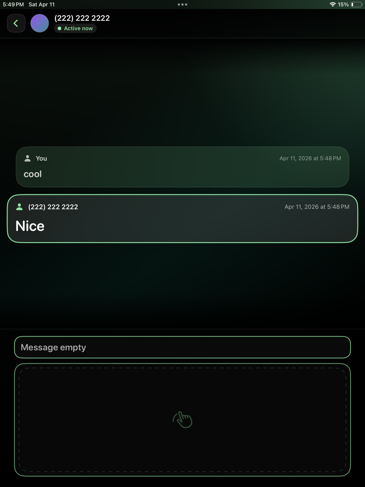
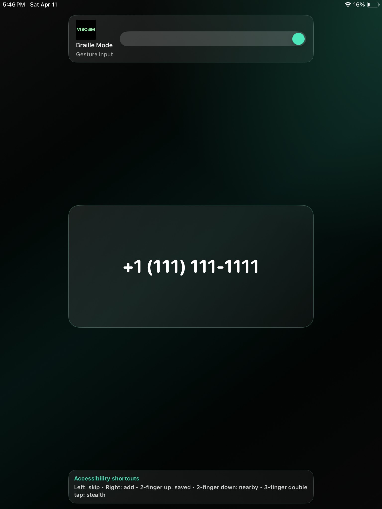

# Vibcom & Vibconnect

**Accessible messaging and nearby connection, with vibration-simulated Braille interaction.**

Vibcom and Vibconnect are companion iOS apps exploring more accessible ways for blind and low-vision people to communicate and meet. Vibcom is the messaging app. Its vibration-simulated Braille feature maps text to the six-dot pattern of a Braille cell and represents each character with timed feedback: active dots use stronger vibrations and tones, while weaker tones mark the other dot positions. Vibcom also offers gesture-based Braille entry, drawn-letter input, and the standard keyboard, with spoken, tone, vibration, and visual feedback. Vibconnect complements messaging with accessible nearby discovery and contact exchange.

The two apps are built separately but share an account identity. Sign in with Vibcom, then use Vibconnect to discover nearby people and connect in person. The project explores accessibility as a complete communication workflow: composing and reading messages, finding people, and carrying a new connection into messaging.

Vibration-simulated Braille is an experimental phone-based representation of Braille patterns, not a physical Braille display or a replacement for one. The project report discusses the interaction design, implementation, and evaluation in more depth.

## The two apps

### Vibcom

- Phone-number sign-in and profile setup
- Contact matching to find existing Vibcom users
- One-to-one conversations backed by Cloud Firestore
- Gesture-based Braille message entry, drawn-letter input, and standard keyboard input
- Vibration-simulated Braille output: timed phone vibrations and tones encode the six-dot cell pattern of text
- Spoken, tone, vibration, and visual feedback for message reading and interaction
- Profile, presence, and accessibility preferences

### Vibconnect

- Nearby profile discovery using location
- On-device contact filtering for discovery results
- Encrypted peer-to-peer exchange using Apple Multipeer Connectivity
- Add an accepted nearby person to device contacts
- Shared Vibcom account identity through an Apple App Group

## How the system fits together

```text
Vibcom ── account, contacts, messaging, Braille-inspired interaction
   │
   ├── Firebase Authentication and Cloud Firestore
   │
   └── shared account identity (Apple App Group)
             │
             └── Vibconnect ── nearby discovery and peer contact exchange
```

The apps are built and signed independently. Firebase stores account, profile, presence, discovery, and conversation data. Vibconnect uses the shared identity to discover profiles and uses encrypted Multipeer Connectivity for an accepted nearby exchange. See [Architecture](docs/ARCHITECTURE.md) and [Data flows and privacy notes](docs/DATA-AND-PRIVACY.md) for more detail.

## Visuals

Representative screens are shown below. These images are taken from the project report's UI appendix.

| Vibcom conversation | Vibconnect nearby discovery |
| --- | --- |
|  |  |

## Built with

- **Swift and SwiftUI** for the iOS applications and interfaces
- **SwiftData** for local profile and conversation state
- **Firebase Authentication** for phone-based account sign-in
- **Cloud Firestore** for profiles, presence, discovery data, and messages
- **Core Location** for nearby discovery
- **Contacts and PhotosUI** for contact matching, contact creation, and local profile image selection
- **Multipeer Connectivity** for encrypted nearby peer exchange
- **Apple App Groups** to share account identity between the apps

## Repository layout

```text
Apps/Vibcom/         Vibcom iOS app and shared Xcode scheme
Apps/Vibconnect/     Vibconnect iOS app and shared Xcode scheme
docs/                Architecture, setup, privacy notes, report, and presentation
scripts/             Swift formatting commands
.github/workflows/   Formatting and simulator build checks
```

## Build and run

### Requirements

- macOS with Xcode 16.4 or later
- iOS 18.5 SDK or later
- A Firebase project with separate iOS registrations for both apps
- An Apple Developer team and App Group for device signing and shared identity

### Setup

1. Open `Apps/Vibcom/Vibcom.xcodeproj` or `Apps/Vibconnect/Vibconnect.xcodeproj` in Xcode.
2. Select the shared `Vibcom` or `Vibconnect` scheme.
3. Follow [Firebase setup](docs/FIREBASE.md) to register both apps and add the Firebase configuration files locally.
4. Replace the checked-in `com.example.www.*` bundle identifiers and `group.com.example.www.vibcom.shared` App Group placeholder with identifiers registered to your team. Keep the App Group consistent across both targets and the source.
5. Allow Xcode to resolve the Firebase iOS SDK Swift Package dependency, then select an iOS Simulator or a signed device and run the app.

Firebase-backed features require a configured Firebase project. This repository does not include Firebase deployment files or Firestore security rules. Configure and review restrictive backend access and data-retention rules before connecting real users. See [Firebase setup](docs/FIREBASE.md) and [Data flows and privacy notes](docs/DATA-AND-PRIVACY.md).

## Development

Run `scripts/lint-swift.sh` to check formatting or `scripts/format-swift.sh` to apply the repository's Swift formatting rules. GitHub Actions checks formatting and builds both apps for the iOS Simulator. The Xcode projects do not currently include automated test targets.

## Project documents

The source and this README provide a quick overview. For the full design rationale, workflows, evaluation, limitations, and additional interface screens, see the [project report](docs/project-report.pdf) and [project presentation](docs/project-presentation.pdf).

- [Architecture](docs/ARCHITECTURE.md)
- [Firebase setup](docs/FIREBASE.md)
- [Data flows and privacy notes](docs/DATA-AND-PRIVACY.md)
- [Project report](docs/project-report.pdf)
- [Project presentation](docs/project-presentation.pdf)

## License

This project is licensed under the [MIT License](LICENSE).
